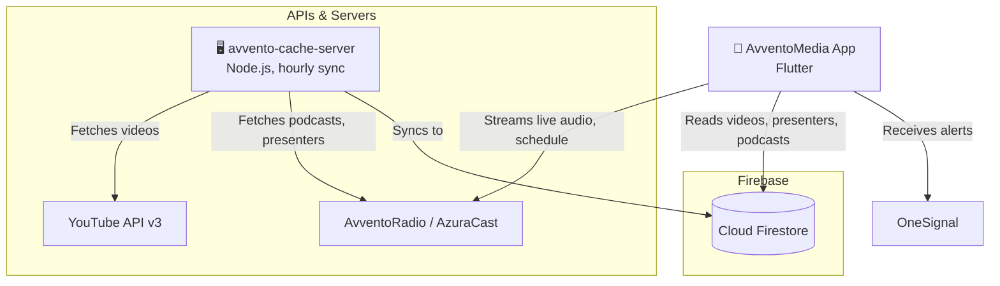

# AvventoMedia App

### Flying the Gospel to the Whole World

AvventoMedia is dedicated to spreading the gospel globally. Its content is branded as AvventoProductions on various platforms including YouTube, Facebook, SoundCloud, and Mixcloud. Additionally, it can be accessed on AvventoRadio at [radio.avventomedia.org](https://radio.avventomedia.org) and on free-to-air 3ABN Uganda Television.

---

## 📱 Features

- **Listen**: Home for audio with a live AvventoRadio card, an "Up next" schedule, Continue listening, a presenters rail, and podcast rails.
- **Presenters & Series**: Presenter pages with tabs for series and single sermons, series pages, and a ring on presenters with new sermons.
- **Podcasts & Audio Player**: Background audio with lock-screen and notification controls, queue reordering, playback speed, and a floating mini player (previous/next, swipe to close).
- **Streaming TV**: Live programs and shows from AvventoMedia and 3ABN Uganda Television. Off-air channels are labelled as such.
- **YouTube Integration (Kids, Music, Main)**: Video content synced from the AvventoProductions YouTube channels, with length badges on thumbnails.
- **Search**: One search across playlists, videos, live TV and radio. It runs on a local index with tabs, filters (date, length, source, sort, downloaded), recent searches and a Browse view.
- **In-list Search**: Long lists (playlists, series, downloads, favorites) get their own pinned search field with sorting and length filters.
- **Offline & Downloads**: Download episodes and videos for offline play. An offline banner links to Downloads and the app shows only what is available.
- **Polish**: Shimmer loading skeletons, the system font with Newsreader for titles, light and dark themes, and accessibility checks (tap targets, labels, contrast).

---

## 🏗 Infrastructure & Tech Stack



- **Frontend**: Flutter & Dart (iOS and Android)
- **State Management**: GetX & Provider
- **Audio**: `just_audio`, `audio_service` and `audio_session` for background play and lock-screen controls
- **Video**: `better_player` and `youtube_player_flutter`
- **Backend & Database**: Cloud Firestore
- **Content Sync**: [avvento-cache-server](https://github.com/AvventoMedia/avvento-cache-server) (Node.js, run hourly by GitHub Actions) copies YouTube data, AzuraCast podcasts and presenters into Firestore. This avoids API quota limits and keeps loading fast.
- **Connectivity**: `connectivity_plus` drives offline mode
- **Push Notifications**: OneSignal

---

## 🚀 CI/CD & Deployment

This repository uses **GitHub Actions**.

- **CI** runs on every pull request and push to `main`: analyze and unit tests, a debug Android build, and an end-to-end smoke test on an Android emulator.
- **Deployment** is triggered **manually** via `workflow_dispatch`:
  1. **Android**: decodes the keystore, builds the signed `.aab`, and uploads it to the Google Play Console.
  2. **iOS**: sets up the keychain, decodes the `.p12` certificate and provisioning profile, builds the signed `.ipa`, and uploads it to TestFlight with `altool`.

*(Never commit keystores or certificates. Store them as Base64 strings in the repository secrets.)*

---

## 🛠 Getting Started (Local Setup)

To run this project locally, you will need the following prerequisites:

1. **Flutter SDK**: `>=3.1.2 <4.0.0`
2. **Firebase Config**: You must obtain the `google-services.json` (Android) and `GoogleService-Info.plist` (iOS) from your Firebase Console and place them in their respective app directories.
3. **Environment Variables**: Copy `.env.example` to `.env` and fill in the keys. The file must exist for the app to build.
4. **Run the App**:
   ```bash
   flutter pub get
   flutter run
   ```
5. **Tests**:
   ```bash
   flutter test                                    # unit, widget and accessibility tests
   flutter test integration_test/app_test.dart     # E2E smoke test (needs a device or emulator)
   ```

---

## 📥 Get the App

Download the AvventoMedia app today:
- [Google Play Store](https://play.google.com/store/apps/details?id=tv.avventomedia.app)
- [Apple App Store](https://apps.apple.com/us/app/avventomedia/id6756179416)

---

## 📌 Notes

- `.env` holds the AzuraCast API key and the EmailJS keys for the prayer request form. It is gitignored but bundled as an asset, so builds fail without it. On fork PRs CI uses an empty one.
- Podcasts and presenters are read from Firestore, not AzuraCast directly. If they look stale, check the cache server's hourly sync.
- Playback notifications on Android 13+ and the iOS lock screen need a real device to verify. Simulators and emulators don't show them reliably.
- Fonts: the system font is used everywhere. Newsreader (serif) is only for titles.
